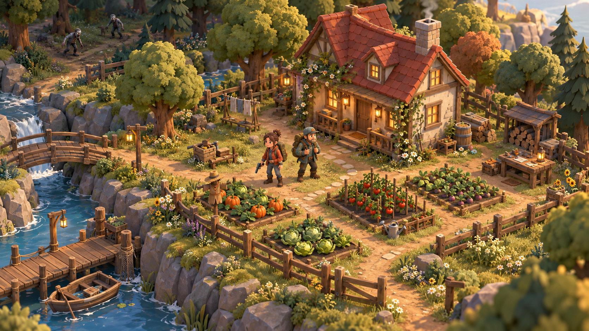

# Boceto visual de ASTRA

Esta imagen es una referencia conceptual para la nueva dirección visual. No es una captura del juego actual ni una promesa de igual detalle en la primera escena 3D.

## Primera escena 3D ejecutada

Estas capturas son del render Three.js de la muestra `/visual.html`. Es una escena estática de revisión: todavía no sustituye el juego multijugador ni sus controles.

### Escritorio

### Celular horizontal emulado

La muestra usa modelos originales por geometría, cámara ortográfica, iluminación y sombras. La captura emulada no confirma rendimiento ni compatibilidad de teléfonos reales.

## Prueba de movimiento

La página `/visual.html` permite mover al personaje naranja por el patio frente a la casa con WASD o flechas en PC y joystick en pantallas táctiles. El segundo personaje permanece quieto. La cámara es fija; esta prueba local todavía no está conectada a las partidas ni al multijugador. El área caminable está limitada al patio para probar los controles antes de ampliar el mapa y sus colisiones. El personaje ahora anima brazos y piernas al caminar y gira suavemente; al detenerse vuelve a su postura de reposo.

Al soltar el control, cambiar de ventana o ocultar la página, el movimiento se detiene. El renderizado se actualiza mientras se camina; la escena permanece en reposo cuando no hay movimiento. Las pruebas con viewport móvil no sustituyen probar en teléfonos reales.

## Pareja de personajes originales

La muestra incorpora dos modelos 3D originales creados con geometría compartida: un personaje masculino con pelo oscuro despeinado, chaqueta terracota, cinturón y mochila con martillo; y uno femenino con pelo castaño recogido, jardinero verde azulado, pañuelo crema y bolso con un paquete de semillas. Se distinguen también las siluetas, puños, botones, bolsillos y detalles de la cara. Ambos conservan articulaciones compatibles con la caminata. En la prueba actual se controla al personaje masculino y el femenino permanece quieto.

Los assets están definidos en `apps/client/src/visual/models.ts` mediante `createFarmer(color, kit, style)`. Son modelos procedurales integrados, todavía no archivos GLB ni un editor de personalización. Las capturas muestran el render real de la escena.

## Estilo caricaturesco implementado

La propuesta caricaturesca aprobada fue adaptada a modelos 3D procedurales: cabezas grandes con cara y pelo agrupados, ojos simples, sonrisa curva, materiales mates y prendas/accesorios de bordes redondeados. Mochila, martillo, pañuelos, jardinero y bolso de semillas mantienen la paleta del concepto. La caminata y el giro se conservan. Las capturas `visual-desktop.png` y `visual-mobile.png` muestran esta implementación real; la lámina generada es una referencia artística y tiene mayor detalle que estos modelos.
