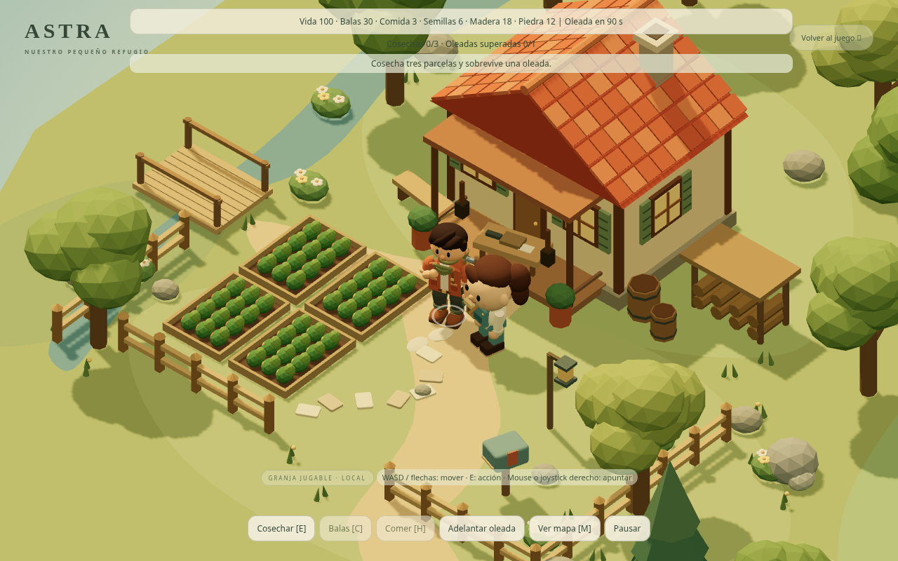
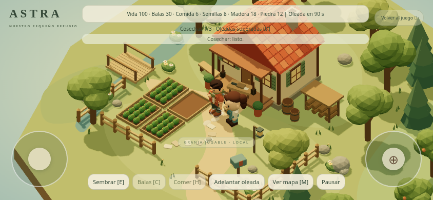
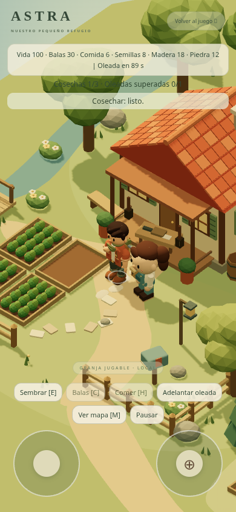
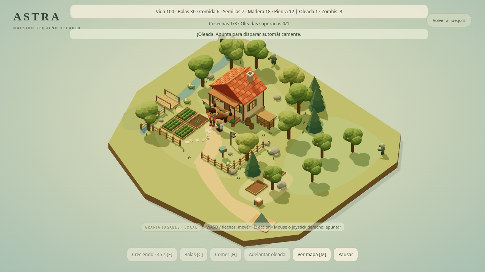

# Arte y granja 3D de ASTRA

La página `/visual.html` es ahora una prueba jugable local: mapa ampliado, cámara que sigue al jugador, cultivos, recursos, fabricación de munición y oleadas suaves de zombis. El objetivo inicial es cosechar tres parcelas y superar una oleada. Ver [guía de juego](jugable.md).

## Capturas reales

Estas imágenes son renders de Three.js y muestran la implementación, no imágenes generadas.

El personaje masculino utiliza el modelo revisado de `male-asset.ts`, con articulaciones y caminata; la protagonista conserva el modelo anterior y permanece quieta. El visor `/visual.html?personaje=1` muestra el masculino de cerca. Teléfonos físicos pendientes de probar.

## Referencias de diseño

Las imágenes generadas son propuestas de estilo, no modelos 3D ni capturas del juego. La implementación actual tiene menos detalle que estas referencias.

- [Granja conceptual](granja-concepto.png).
- [Propuesta realista](personajes-propuesta-estilo.png).
- [Propuesta caricaturesca aprobada](personajes-propuesta-caricaturesca.png).
- [Modelo 3D revisado de frente](personaje-modelado-frente.png) y [espalda](personaje-modelado-espalda.png).

Los modelos son assets originales procedurales definidos en código; todavía no hay exportación GLB ni editor de personalización. La prueba local reinicia al recargar y permanece separada de las partidas cooperativas del juego anterior.
